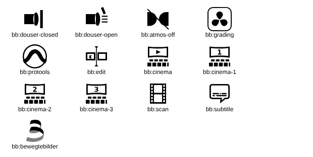

# bb_icon – Icon-Set für Home Assistant

Eigenes Icon-Set mit dem Präfix `bb:` für die Home-Assistant-Instanzen von Bewegte Bilder.

## Icons

| Name | Icon |
|---|---|
| `bb:douser-closed` |  |
| `bb:douser-open` |  |
| `bb:atmos-off` |  |
| `bb:grading` |  |
| `bb:protools` |  |
| `bb:edit` |  |
| `bb:cinema` |  |
| `bb:cinema-1` |  |
| `bb:cinema-2` |  |
| `bb:cinema-3` |  |
| `bb:scan` |  |
| `bb:subtitle` |  |
| `bb:bewegtebilder` |  |

`bb:bewegtebilder` ist zweistufig (`secondaryPath`): Der zweite Teil wird von Home Assistant halbtransparent gezeichnet.

## Einbinden

1. `bb-icons.js` in Home Assistant als Dashboard-Ressource vom Typ **JavaScript-Modul** eintragen
   (Einstellungen → Dashboards → Ressourcen), z. B. nach `/config/www/bb-icons.js` kopieren und `/local/bb-icons.js?v=1` eintragen.
2. Browser hart neu laden.
3. Icons wie gewohnt verwenden, z. B. `icon: bb:grading`.

## Aufbau

- `bb-icons.js` – das Icon-Set, so wie es in Home Assistant geladen wird
- `svg/` – jedes Icon einzeln als SVG

## Hinweis

`atmos-off`, `grading` und `protools` basieren auf Logos der jeweiligen Hersteller (Dolby, Blackmagic Design, Avid)
und sind nur für den internen Einsatz gedacht. Die Markenrechte liegen bei den Herstellern.
